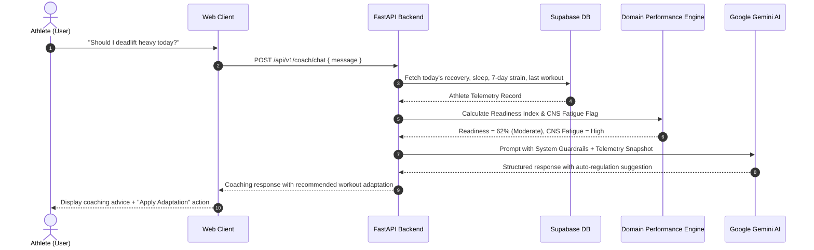

# AthlonIQ — AI Performance & Physique Coach Design

## 1. System Vision
The AthlonIQ AI Coach acts as an elite, evidence-based performance specialist combining sports physiology, hypertrophy biomechanics, sports nutrition, and recovery science.

Instead of generic chat, the coach receives a **Structured Athlete Telemetry Snapshot (SATS)** before generating advice:
- Current Recovery & Sleep Score (HRV, sleep stages)
- 7-Day Cumulative Training Load & Strain
- Today's Nutrition Delta (Calories, Protein vs Target)
- 1RM Trends and volume changes in primary compounds
- Injury flags or reported muscle soreness

---

## 2. Architecture of the Intelligence Loop



---

## 3. Context Injection Schema (SATS)
```json
{
  "athlete": {
    "tier": "intermediate",
    "goal": "hypertrophy",
    "weight_kg": 78.5,
    "target_calories": 2650
  },
  "today_recovery": {
    "sleep_hours": 6.2,
    "quality_score": 68,
    "hrv_rmssd_ms": 42,
    "hrv_baseline_delta_pct": -14.5,
    "readiness_score": 61
  },
  "recent_strain": {
    "yesterday_workout": "Heavy Lower Body (Squat 140kg x 5)",
    "7day_volume_kg": 42500,
    "soreness_hotspots": ["hamstrings", "erector_spinae"]
  }
}
```

---

## 4. Coaching Guardrails & Philosophy
1. **Safety & Injury Prevention**: Never recommend training through sharp joint pain, tendon inflammation, or extreme systemic exhaustion.
2. **Auto-Regulation Over Dogma**: When readiness is compromised (>15% drop in HRV or <5.5 hours sleep), proactively suggest reducing load by 10-20% or swapping compound movements for machine alternatives.
3. **Evidence-Based Nutrition**: Follow ISSN (International Society of Sports Nutrition) guidelines for protein distribution ($1.6 - 2.2g/kg$).
