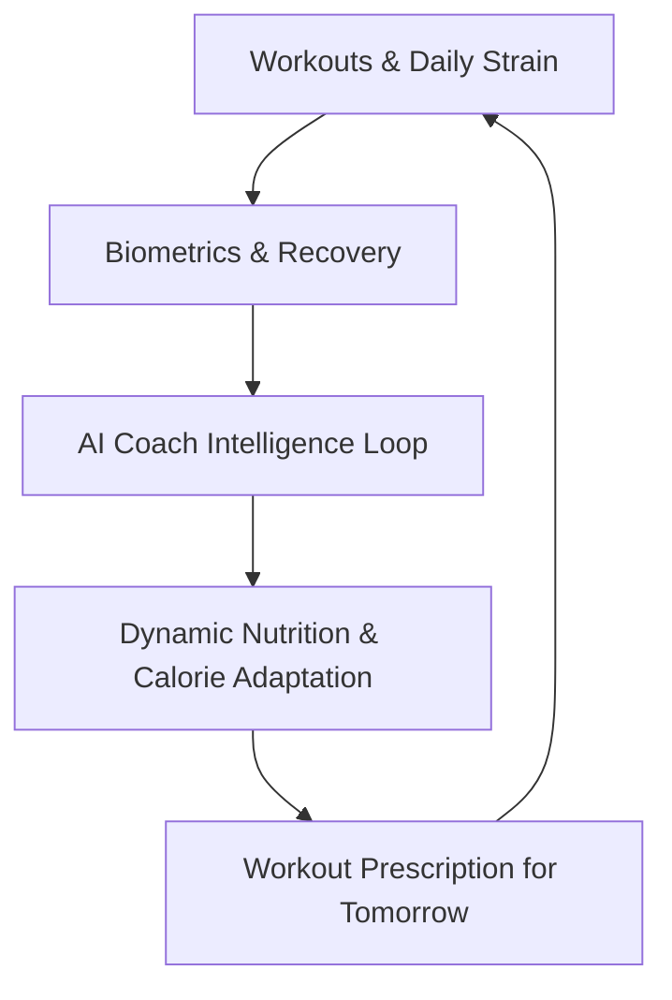
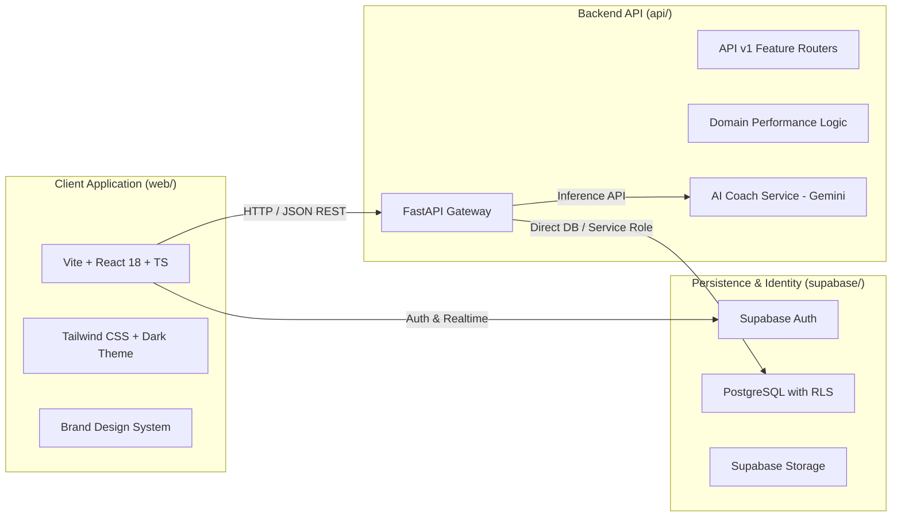

# AthlonIQ — System Architecture Specification

## 1. System Vision
AthlonIQ is built on the premise that an athlete's physical progress is a closed-loop cybernetic system:


Every input (training log, biometric read, nutrition intake, body check) feeds into the **AthlonIQ Intelligence Core**, which recomputes readiness, adjusts macro thresholds, and suggests intelligent training modifications.

---

## 2. High-Level Architecture

AthlonIQ utilizes a modern decoupled monorepo architecture:



### 2.1 Web Client (`web/`)
- Built with **React**, **TypeScript**, and **Vite**.
- Component architecture divided into atomic UI building blocks (`components/ui/`) and domain features (`features/`):
  - `dashboard`: Daily readiness, quick workout starter, macro summary widget.
  - `profile`: Biometric baselines, height, weight, body fat %, fitness tier.
  - `nutrition`: Meal planning, macro splits (protein/carbs/fats), hydration.
  - `workouts`: Multi-split builder, live training logger, set-by-set RPE tracking.
  - `activities`: Cardio, HIIT, steps, and energy expenditure logs.
  - `recovery`: Sleep staging, HRV trend lines, resting heart rate analysis.
  - `progress`: 1RM strength curves, weight trendlines, photo comparison.
  - `coach`: Conversational AI chat with deep context injection.

### 2.2 Intelligence Engine (`api/`)
- Built with **FastAPI** (Python 3.12+).
- **Core Domain Services**:
  - `ReadinessCalculator`: Combines sleep score, HRV z-score, and cumulative 7-day strain.
  - `OverloadEngine`: Calculates volume load ($Volume = Reps \times Weight$) and auto-recommends next weight/rep targets based on RIR (Reps in Reserve).
  - `MacroCalculator`: Calculates TDEE via Katch-McArdle or Mifflin-St Jeor formula and dynamically shifts carbohydrate/fat ratios on training vs rest days.
  - `CoachAgent`: Orchestrates athlete context, history, and goals into structured prompts for Google Gemini.

### 2.3 Database & Security Layer (`supabase/`)
- Managed PostgreSQL instance with native Row Level Security.
- Auth handles JWT issuing, email/password or OAuth athlete logins.
- Every athlete table strictly enforces `user_id = auth.uid()`.

---

## 3. Communication Contracts
- All backend endpoints follow the `/api/v1/` prefix.
- Standard JSON responses with unified error structures:
```json
{
  "success": true,
  "data": { ... },
  "message": "Operation completed successfully"
}
```
- In case of validation or processing error:
```json
{
  "success": false,
  "error": {
    "code": "VALIDATION_ERROR",
    "message": "Detailed error explanation",
    "details": [ ... ]
  }
}
```
