# AthlonIQ — Database Design Specification & Canonical Schema

## 1. Overview
The AthlonIQ persistence layer runs on **PostgreSQL** (managed via Supabase). The schema is strictly aligned with the application state model defined in [`web/src/hooks/useAthloniqState.tsx`](file:///c:/Users/vijay/OneDrive/Documents/GitHub/AthlonIQ/web/src/hooks/useAthloniqState.tsx). Every user-owned table enforces Row Level Security (RLS) with explicit, non-overlapping policies ensuring zero data leakage between athletes and zero public/anon access.

---

## 2. Canonical Tables Mapping

Each frontend state slice in `useAthloniqState.tsx` maps deterministically to exactly **ONE** canonical PostgreSQL table:

| State Slice (`useAthloniqState.tsx`) | Canonical PostgreSQL Table | Primary Key / User Reference | Legacy / Deprecated Overlaps Eliminated |
| :--- | :--- | :--- | :--- |
| **`profile`** (`UserProfile`) | `public.profiles` | `id UUID PK REFERENCES auth.users(id) ON DELETE CASCADE` | None (Single profile table retained) |
| **`equipment`** (`EquipmentItem[]`) | `public.user_equipment` | `user_id UUID REFERENCES auth.users(id) ON DELETE CASCADE` | None |
| **`goals`** (`UserGoals`) | `public.user_goals` | `user_id UUID REFERENCES auth.users(id) ON DELETE CASCADE` | None |
| **`preferences`** (`UserPreferences`) | `public.user_preferences` | `user_id UUID REFERENCES auth.users(id) ON DELETE CASCADE` | None |
| **`checkin`** (`RecoveryCheckIn`) | `public.recovery_logs` | `user_id UUID REFERENCES auth.users(id) ON DELETE CASCADE` | Eliminated conflicting `recovery_logs` duplicate definitions across migrations |
| **`foodEntries`** (`FoodEntry[]`) | `public.food_entries` | `user_id UUID REFERENCES auth.users(id) ON DELETE CASCADE` | Eliminated `nutrition_logs` and `meals` parent/child overlap in favor of flat atomic entries |
| **`customFoods`** (catalog extensions) | `public.custom_foods` | `user_id UUID REFERENCES auth.users(id) ON DELETE CASCADE` | Retained as user-owned food extensions |
| **`workoutSessions`** (`WorkoutSession[]`) | `public.workout_sessions` | `user_id UUID REFERENCES auth.users(id) ON DELETE CASCADE` | Eliminated conflicting `workouts` & `workout_exercises` hierarchy |
| **`workoutSessions.sets`** (`ExerciseSet[]`) | `public.exercise_sets` | `user_id UUID REFERENCES auth.users(id) ON DELETE CASCADE`, `session_id UUID REFERENCES public.workout_sessions(id) ON DELETE CASCADE` | Eliminated duplicate `exercise_sets` definition and added direct `user_id` FK |
| **`workoutTemplates`** (`WorkoutTemplate[]`) | `public.workout_templates` | `user_id UUID REFERENCES auth.users(id) ON DELETE CASCADE` | Retained |
| **`workoutTemplateExercises`** | `public.workout_template_exercises` | `user_id UUID REFERENCES auth.users(id) ON DELETE CASCADE`, `template_id UUID REFERENCES public.workout_templates(id) ON DELETE CASCADE` | Added missing `user_id` FK and enabled RLS |
| **`activitySessions`** (`ActivitySession[]`) | `public.activity_sessions` | `user_id UUID REFERENCES auth.users(id) ON DELETE CASCADE` | Retained |
| **`bodyMetrics`** (`BodyMetric[]`) | `public.body_metrics` | `user_id UUID REFERENCES auth.users(id) ON DELETE CASCADE` | Eliminated duplicate `athlete_metrics` table |
| **`coachMessages`** (`EpistemicCoachMessage[]`) | `public.coach_messages` | `user_id UUID REFERENCES auth.users(id) ON DELETE CASCADE`, `conversation_id UUID REFERENCES public.coach_conversations(id) ON DELETE CASCADE` | Eliminated duplicate `coach_messages` and legacy `coach_sessions` |
| **`coachConversations`** | `public.coach_conversations` | `user_id UUID REFERENCES auth.users(id) ON DELETE CASCADE` | Replaced legacy `coach_sessions` |
| **`weeklyReports`** (`WeeklyReviewReport`) | `public.weekly_reports` | `user_id UUID REFERENCES auth.users(id) ON DELETE CASCADE` | Retained |
| **`progressPhotos`** (`ProgressPhotoAsset[]`) | `public.progress_photos` | `user_id UUID REFERENCES auth.users(id) ON DELETE CASCADE` | Standardized table name; linked to private `progress-photos` storage bucket |
| **Exercise Catalog** | `public.exercises` | Global reference catalog (`user_id IS NULL` for standard exercises; nullable `user_id` for custom) | Retained with authenticated read access |

---

## 3. Entity Relationship Diagram

```mermaid
erDiagram
    AUTH_USERS ||--|| PROFILES : "1:1 identity"
    AUTH_USERS ||--o{ USER_EQUIPMENT : "owns"
    AUTH_USERS ||--|| USER_GOALS : "configures"
    AUTH_USERS ||--|| USER_PREFERENCES : "configures"
    AUTH_USERS ||--o{ BODY_METRICS : "logs weigh-ins"
    AUTH_USERS ||--o{ RECOVERY_LOGS : "logs sleep & soreness"
    AUTH_USERS ||--o{ FOOD_ENTRIES : "logs meals"
    AUTH_USERS ||--o{ CUSTOM_FOODS : "creates"
    AUTH_USERS ||--o{ WORKOUT_TEMPLATES : "creates"
    WORKOUT_TEMPLATES ||--o{ WORKOUT_TEMPLATE_EXERCISES : "defines"
    AUTH_USERS ||--o{ WORKOUT_SESSIONS : "logs training"
    WORKOUT_SESSIONS ||--o{ EXERCISE_SETS : "contains sets"
    AUTH_USERS ||--o{ EXERCISE_SETS : "owns"
    AUTH_USERS ||--o{ ACTIVITY_SESSIONS : "logs cardio & sports"
    AUTH_USERS ||--o{ COACH_CONVERSATIONS : "initiates"
    COACH_CONVERSATIONS ||--o{ COACH_MESSAGES : "contains"
    AUTH_USERS ||--o{ COACH_MESSAGES : "owns"
    AUTH_USERS ||--o{ WEEKLY_REPORTS : "receives"
    AUTH_USERS ||--o{ PROGRESS_PHOTOS : "uploads"
```



---

## 4. Key Rules & Constraints

### 4.1 Strict Row-Level Security (RLS) Protocol
1. **RLS Enabled Universally:** Every table in `public` has `ALTER TABLE <table_name> ENABLE ROW LEVEL SECURITY;` applied.
2. **Role Restrictions:** All user data policies target `TO authenticated`. Zero access is granted to role `anon`.
3. **Provable Isolation:**
   - `SELECT`: `USING ((select auth.uid()) = user_id)`
   - `INSERT`: `WITH CHECK ((select auth.uid()) = user_id)`
   - `UPDATE`: `USING ((select auth.uid()) = user_id) WITH CHECK ((select auth.uid()) = user_id)`
   - `DELETE`: `USING ((select auth.uid()) = user_id)`
   *(On `profiles`, `id` is the user UUID referencing `auth.users(id)`).*
4. **Children Include Direct `user_id`:** Child tables such as `exercise_sets`, `workout_template_exercises`, and `coach_messages` carry a direct `user_id UUID REFERENCES auth.users(id) ON DELETE CASCADE` so RLS checks execute with immediate indexing without costly multi-table joins.

### 4.2 Provenance Check Constraints
Allowed values across `user_goals`, `food_entries`, and `custom_foods`:
```sql
CHECK (provenance IN (
  'user_confirmed',
  'calculated_estimate',
  'provisional_default',
  'verified_reference',
  'manual_entry',
  'user_corrected',
  'ai_estimated'
))
```

### 4.3 Data Integrity & Numeric Ranges
- **Body Weight:** `CHECK (weight_kg > 0 AND weight_kg <= 500)`
- **Sleep Hours:** `CHECK (sleep_hours >= 0 AND sleep_hours <= 24)`
- **Sleep Quality, Soreness, Fatigue:** `CHECK (val BETWEEN 1 AND 5)`
- **Readiness Score:** `CHECK (readiness_score BETWEEN 0 AND 100)`
- **Calories & Macros:** `CHECK (val >= 0)`
- **Known Unknowns Default to NULL:** Sex, waist measurement, experience level, split preferences, and baseline sleep hours default to `NULL` until explicitly provided by the athlete.
- **Home Gym Verification:** Equipment items default to `is_confirmed = false` until verified.

### 4.4 Automated Timestamps
All tables maintain `created_at TIMESTAMPTZ DEFAULT NOW() NOT NULL` and `updated_at TIMESTAMPTZ DEFAULT NOW() NOT NULL` managed via a `BEFORE UPDATE` trigger executing `public.handle_updated_at()`.

### 4.5 Time-Series Performance Indexes
Compound B-Tree indexes on `(user_id, date)` columns ensure sub-millisecond retrieval of athlete histories:
- `idx_recovery_logs_user_date ON recovery_logs(user_id, logged_date DESC)`
- `idx_food_entries_user_date ON food_entries(user_id, logged_date DESC)`
- `idx_workout_sessions_user_date ON workout_sessions(user_id, logged_date DESC)`
- `idx_activity_sessions_user_date ON activity_sessions(user_id, logged_date DESC)`
- `idx_body_metrics_user_date ON body_metrics(user_id, logged_date DESC)`
- `idx_progress_photos_user_date ON progress_photos(user_id, logged_date DESC)`
- `idx_weekly_reports_user_date ON weekly_reports(user_id, week_start_date DESC)`

### 4.6 Storage Buckets & Policies
Two private Supabase storage buckets are configured:
- `meal-photos` (private, max file size 15MB, images only)
- `progress-photos` (private, max file size 25MB, images only)

Enforced storage policy:
```sql
CREATE POLICY "owner_storage_access" ON storage.objects
  FOR ALL TO authenticated
  USING ((storage.foldername(name))[1] = (select auth.uid())::text)
  WITH CHECK ((storage.foldername(name))[1] = (select auth.uid())::text);
```
Anon users have zero read or write access to athlete photos.

---

## 5. RLS Test Suite Execution

AthlonIQ includes an automated test harness powered by `@electric-sql/pglite` that simulates an in-memory Supabase environment without requiring any live cloud database credentials.

To run the complete RLS and schema test suite:
```bash
npm run test:rls
```
The test verifies:
1. Every table in schema `public` has RLS enabled.
2. Every table has explicit `SELECT`, `INSERT`, `UPDATE`, and `DELETE` policies defined.
3. User A cannot select User B's rows.
4. User A cannot insert rows using User B's `user_id`.
5. User A cannot update User B's rows.
6. User A cannot delete User B's rows.
7. Role `anon` receives 0 rows and is rejected on all writes.
