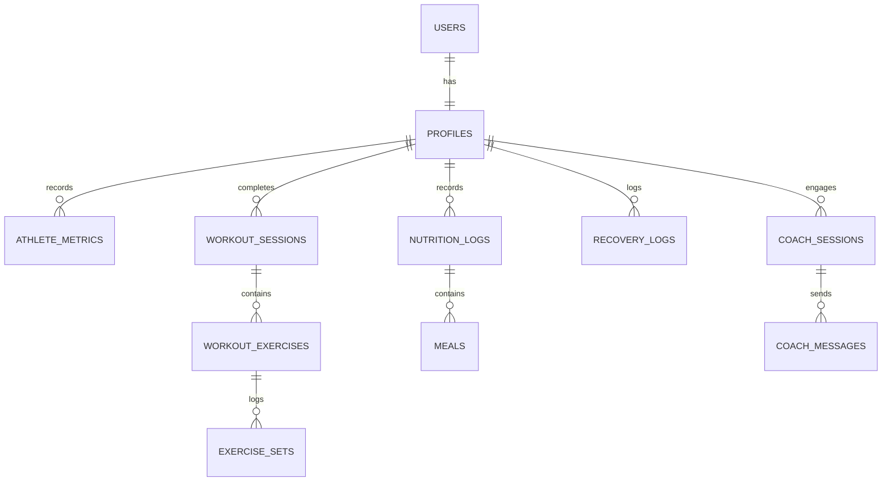

# AthlonIQ — Database Design Specification

## 1. Overview
The AthlonIQ persistence layer runs on **PostgreSQL** (managed via Supabase). The schema is optimized for athlete telemetry, time-series biometric tracking, workout logging, nutrition tracking, and AI coaching sessions with Row Level Security (RLS) enabled on every table.

---

## 2. Entity Relationship Model



---

## 3. Core Tables

### 3.1 `profiles`
Stores athlete personal baselines, preferences, and physique targets.
- `id` (UUID, PK, references `auth.users.id` on delete cascade)
- `email` (TEXT)
- `full_name` (TEXT)
- `date_of_birth` (DATE)
- `gender` (TEXT: 'male', 'female', 'other')
- `height_cm` (NUMERIC)
- `experience_level` (TEXT: 'beginner', 'intermediate', 'advanced', 'elite')
- `primary_goal` (TEXT: 'hypertrophy', 'strength', 'fat_loss', 'recomposition', 'endurance')
- `target_weight_kg` (NUMERIC)
- `activity_multiplier` (NUMERIC, default 1.375)
- `created_at`, `updated_at` (TIMESTAMPTZ)

### 3.2 `athlete_metrics`
Time-series physique logs (weigh-ins, circumference measurements, body fat %).
- `id` (UUID, PK, default `gen_random_uuid()`)
- `user_id` (UUID, FK -> `profiles.id`)
- `recorded_at` (TIMESTAMPTZ)
- `weight_kg` (NUMERIC, NOT NULL)
- `body_fat_pct` (NUMERIC)
- `muscle_mass_kg` (NUMERIC)
- `chest_cm`, `waist_cm`, `hips_cm`, `arms_cm`, `thighs_cm` (NUMERIC)
- `notes` (TEXT)

### 3.3 `workouts` & `workout_exercises` & `exercise_sets`
- `workouts`: Holds workout session metadata (date, split name, duration, total volume load, perceived exertion RPE, notes).
- `workout_exercises`: Exercise entries in a workout session (exercise ID/name, order index, target sets/reps).
- `exercise_sets`: Set-by-set breakdown (set number, weight in kg, reps completed, RPE, is_warmup, is_failure).

### 3.4 `nutrition_logs` & `meals`
- `nutrition_logs`: Daily aggregation (date, target calories, target protein/carbs/fat, logged calories/macros, water ml).
- `meals`: Discrete meals logged within the day (meal type: breakfast/lunch/dinner/snack/pre-workout/post-workout, food items, macro breakdown).

### 3.5 `recovery_logs`
- Stores daily recovery & sleep biometric readings (sleep duration minutes, sleep quality score 0-100, resting heart rate, HRV rMSSD, soreness score 1-10, readiness score 0-100).

### 3.6 `coach_sessions` & `coach_messages`
- AI conversation threads with athlete context snapshots and message history.

---

## 4. Row Level Security (RLS) Rules
Every table follows the strict principle:
```sql
ALTER TABLE table_name ENABLE ROW LEVEL SECURITY;

CREATE POLICY "Athletes can view own data"
  ON table_name FOR SELECT
  USING (auth.uid() = user_id);

CREATE POLICY "Athletes can insert own data"
  ON table_name FOR INSERT
  WITH CHECK (auth.uid() = user_id);

CREATE POLICY "Athletes can update own data"
  ON table_name FOR UPDATE
  USING (auth.uid() = user_id);

CREATE POLICY "Athletes can delete own data"
  ON table_name FOR DELETE
  USING (auth.uid() = user_id);
```
