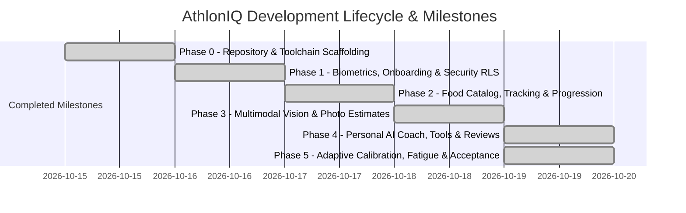

# AthlonIQ — Engineering Roadmap & Milestones



---

## Phase Execution Summary

### Phase 0: Repository & Scaffolding (Completed)
- [x] Monorepo architecture (`web/`, `api/`, `supabase/`, `docs/`).
- [x] Workspace rules (`AGENTS.md`) and core documentation.
- [x] Base Supabase migration schema & seed files.
- [x] FastAPI skeleton with health endpoints, Pydantic schemas, and Pytest suite.
- [x] Vite + React + TypeScript + Tailwind CSS web skeleton with brand tokens.

### Phase 1: Biometric Baseline, Goals & Database Foundation (Completed)
- [x] Supabase Auth & Row-Level Security (RLS) policies on all tables.
- [x] Mathematical biometric engines (Mifflin-St Jeor BMR, BMI, 1.6–2.2 g/kg protein reference).
- [x] Onboarding wizard: Biometrics, Training Split, Home Gym Equipment Confirmation, and Lean-Bulk Goals.
- [x] Caloric target gating until complete baseline data is confirmed.
- [x] Auditable provenance markers on all calculations (`calculated_estimate`, `provisional_default`).

### Phase 2: Indian Food Catalog, Workout Progressions & Weight Trends (Completed)
- [x] Indian & Athletic Food Catalog (22+ verified staples with macro profiles).
- [x] Daily food entry tracking with strict exclusion of unconfirmed estimates from totals.
- [x] Double-progression overload engine respecting home gym caps (70 kg free-weights) and reps/tempo.
- [x] 7-day rolling weight trend with insufficient data gate (< 3 entries).
- [x] Multi-sport session logging (Badminton, Running pace in MM:SS /km, Calisthenics).

### Phase 3: Multimodal Vision & Meal Image Estimator (Completed)
- [x] Gemini 2.5 Flash multimodal food image analysis with structured output.
- [x] Mandatory AI estimation isolation: entries flagged as `ai_estimated` and `is_confirmed = False`.
- [x] Athlete confirmation flow (`Confirm & Add to Daily Totals`) before mutations.
- [x] Deterministic mock fallback when `GEMINI_API_KEY` is not configured.

### Phase 4: Personal AI Coach, 8 Typed Allowlisted Tools & Weekly Reviews (Completed)
- [x] 8 allowlisted typed tools operating exclusively over user-scoped snapshots.
- [x] Medical safety escalation filter triggering immediate clinical guidance on red-flag symptoms.
- [x] Deterministic weekly review generator with priority recommendations.
- [x] Provider-independent `CoachService` with full offline fallback.

### Phase 5: Adaptive Calibration, Fatigue Flags, Photos, Data Portability & Final Acceptance (Completed)
- [x] 14-day deterministic lean-bulk energy calibration (`+0.10 to +0.25 kg/wk` corridor, +150/-150 kcal deltas).
- [x] Multi-sport cumulative workload fatigue advisory (Lifting + Badminton + Running + Sleep/Soreness).
- [x] Private Progress Photo Timeline with side-by-side comparison and scientific disclaimer.
- [x] Complete Data Portability: JSON Archive export, CSV export, and two-step permanent data wipe.
- [x] 12-point end-to-end acceptance test suite (`api/tests/test_phase5_acceptance.py`) with 100% pass rate (108/108 passing tests).
- [x] PWA manifest, meta tags, and production Vite bundle verification.

---

## Deployment & Production Operation

### Supabase Database Migrations
Run versioned migrations in order:
```bash
supabase db push
# Or apply via psql / Supabase SQL Editor:
# 1. supabase/migrations/20261019000001_initial_schema.sql
# 2. supabase/migrations/20261019000002_phase3_vision.sql
# 3. supabase/migrations/20261019000003_phase4_coach_and_reviews.sql
```

### Vercel Deployment (Frontend `web/`)
1. Root directory: `web`
2. Build command: `npm run build`
3. Output directory: `dist`
4. Environment variables:
   - `VITE_API_BASE_URL`: `https://your-api-domain.onrender.com`
   - `VITE_SUPABASE_URL`: `https://your-project.supabase.co`
   - `VITE_SUPABASE_ANON_KEY`: `your-supabase-anon-key`

### Render Deployment (Backend `api/`)
1. Root directory: `api`
2. Environment: `Python 3.12+`
3. Build command: `pip install -r requirements.txt`
4. Start command: `uvicorn app.main:app --host 0.0.0.0 --port $PORT`
5. Environment variables:
   - `ENVIRONMENT`: `production`
   - `SUPABASE_URL`: `https://your-project.supabase.co`
   - `SUPABASE_JWT_SECRET`: `your-supabase-jwt-secret`
   - `GEMINI_API_KEY`: `your-gemini-api-key` (optional; deterministic fallback active if omitted)
