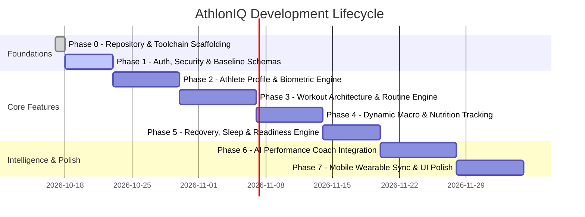

# AthlonIQ — Engineering Roadmap

---

## Phase Breakdown

### Phase 0: Repository & Scaffolding (Current)
- [x] Workspace initialization, Git repo configuration.
- [x] Workspace rules (`AGENTS.md`) and core documentation (`docs/`).
- [x] Base Supabase migration schema & seed files.
- [x] FastAPI skeleton with health endpoints, Pydantic schemas, and Pytest suite.
- [x] Vite + React + TypeScript + Tailwind CSS web skeleton with brand tokens.
- [x] Verification of clean build and test runners.

### Phase 1: Authentication & Data Foundation
- [ ] Supabase Auth integration (Email/Password, OAuth, Session recovery).
- [ ] User profile creation triggers and default biometric baseline seeding.
- [ ] Frontend Protected Route wrapper and Auth context.
- [ ] API JWT validation middleware.

### Phase 2: Athlete Profile & Biometric Engine
- [ ] Physique goal configuration (Cut, Bulk, Maintenance, Recomp).
- [ ] Time-series body weight and circumference logging.
- [ ] Body fat % calculation methods (Navy method, calipers, DEXA manual entry).
- [ ] Interactive weight and body composition charts.

### Phase 3: Workout & Activity Engine
- [ ] Exercise library with muscle group categorization and movement patterns.
- [ ] Workout builder (sets, reps, target RPE, rest timers).
- [ ] Live workout execution mode with auto-calculated volume load and progressive overload indicators.
- [ ] Cardio and daily activity logging.

### Phase 4: Dynamic Macro & Nutrition Tracking
- [ ] Dynamic TDEE calculation (Katch-McArdle / Mifflin-St Jeor).
- [ ] Carb/Fat cycling between training days vs rest days.
- [ ] Daily meal logger with macro breakdown (Protein, Carbohydrates, Fats, Fiber).
- [ ] Hydration tracker.

### Phase 5: Recovery, Sleep & Readiness Engine
- [ ] Daily sleep tracking (duration, quality score, sleep stage breakdown).
- [ ] Resting heart rate and HRV (rMSSD) trend tracking.
- [ ] Composite Readiness Score algorithm combining recovery, soreness, and 7-day cumulative strain.

### Phase 6: Autonomous AI Performance Coach
- [ ] Multi-turn chat interface with streaming responses.
- [ ] Structured context injection: today's recovery, recent strain, nutrition delta.
- [ ] Proactive workout auto-regulation suggestions (e.g. deload detection).
- [ ] Weekly progress audit generation.

### Phase 7: Mobile/Wearable Sync & UI Polish
- [ ] Apple Health / Google Health Connect data import pipelines.
- [ ] PWA offline support and push notifications for hydration/rest timers.
- [ ] Performance optimizations, bundle splitting, and end-to-end testing.
