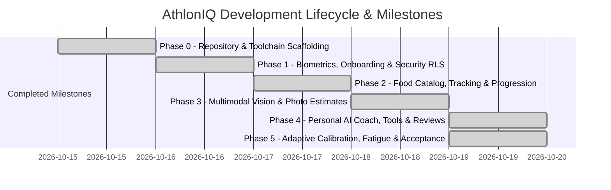

# AthlonIQ — Engineering Roadmap & Milestones



---

## Phase Execution Summary

### Phase 0: Repository & Scaffolding (Completed)
- [x] Monorepo architecture (`web/`, `api/`, `supabase/`, `tools/`, `docs/`).
- [x] Workspace rules (`AGENTS.md`) and core documentation.
- [x] Base Supabase migration schema & seed files.
- [x] FastAPI skeleton with health endpoints, Pydantic v2 schemas, and Pytest suite.
- [x] Vite + React + TypeScript + Tailwind CSS web skeleton with brand tokens.
- [x] CI workflow (`.github/workflows/ci.yml`) with automated secret scanning, Pytest, Web build + Vitest, and hermetic RLS tests.

### Phase 1: Biometric Baseline, Goals & Database Foundation (Completed)
- [x] Supabase Auth & Row-Level Security (RLS) policies on all tables.
- [x] Mathematical biometric engines (Mifflin-St Jeor BMR, BMI, 1.6–2.2 g/kg protein reference).
- [x] Onboarding wizard: Biometrics, Training Split, Home Gym Equipment Confirmation, and Lean-Bulk Goals.
- [x] Caloric target gating until complete baseline data is confirmed (zero fabricated defaults).
- [x] Auditable provenance markers on all calculations (`calculated_estimate`, `provisional_default`, `user_confirmed`).

### Phase 2: Indian Food Catalog, Workout Progressions & Weight Trends (Completed)
- [x] Indian & Athletic Food Catalog (22+ staples with macro profiles sourced from ICMR 2017 & standard benchmarks).
- [x] Daily food entry tracking with strict exclusion of unconfirmed estimates from daily totals.
- [x] Double-progression overload engine respecting home gym caps (70 kg free-weights) and reps/tempo progressions.
- [x] 7-day rolling weight trend with insufficient data gate (< 3 entries).
- [x] Multi-sport session logging (Badminton, Running pace in MM:SS /km, Calisthenics).

### Phase 3: Multimodal Vision & Meal Image Estimator (Completed)
- [x] Gemini 2.5 Flash multimodal food image analysis with structured output schema.
- [x] Mandatory AI estimation isolation: entries flagged as `ai_estimated` and `is_confirmed = False`.
- [x] Vision API fallback: on API failure returns 0 candidates, provider `"mock"`, mode `"fallback"`, and `"Vision unavailable — log manually"` prompt with direct manual logging action.
- [x] Demo mode: returns labelled sample candidates only when explicitly requested in non-production environments.
- [x] Strict production protection: client `force_mode` overrides are unconditionally rejected in `ENVIRONMENT=production`.
- [x] Athlete confirmation flow (`Confirm & Add to Daily Totals`) before any database mutations.

### Phase 4: Personal AI Coach, 8 Typed Allowlisted Tools & Weekly Reviews (Completed)
- [x] 8 allowlisted typed tools operating exclusively over user-scoped snapshots.
- [x] Medical safety escalation filter triggering immediate clinical guidance on red-flag symptoms.
- [x] Deterministic weekly review generator with priority recommendations.
- [x] Provider-independent `CoachService` with full offline fallback and retry actions without synthesized data.

### Phase 5: Adaptive Calibration, Fatigue Flags, Photos, Data Portability & Acceptance (Completed)
- [x] 14-day deterministic lean-bulk energy calibration (`+0.10 to +0.25 kg/wk` corridor, +150/-150 kcal deltas).
- [x] Multi-sport cumulative workload fatigue advisory (Lifting + Badminton + Running + Sleep/Soreness).
- [x] Private Progress Photo Timeline with side-by-side comparison, weight stamps, and scientific visual-only disclaimer.
- [x] Complete Data Portability: JSON Archive export, CSV export, and two-step permanent data wipe.
- [x] 12-point end-to-end acceptance test suite (`api/tests/test_phase5_acceptance.py`) with 100% pass rate (12/12 acceptance tests, 154/154 total backend tests passing).
- [x] PWA manifest, meta tags, and production Vite bundle verification (31 precache entries).

---

## Current Test Execution Matrix

All metrics below reflect live, un-doctored terminal runs recorded in [`docs/HANDOFF_STATE.md`](HANDOFF_STATE.md):

| Test Suite | Command | Scope & Contracts | Raw Result | Status |
| :--- | :--- | :--- | :--- | :--- |
| **Backend Pytest** (`api/`) | `pytest` | API routes, PyJWKClient JWT auth, CORS allowlists, timezone resolution, rate limits with trusted proxies, vision fallback & demo modes, coach tools, acceptance contracts | **154 passed**, 2 warnings (4.40s) | ✅ PASS |
| **Web Vitest** (`web/`) | `npm test` | React UI, routing, PWA caching, optimistic rollback, auth gate, progression fallbacks, recovery slider, profile BMI, offline weekly review, Lane B3 null states, MealPhotoUploader & CandidateReview (0 `act` warnings) | **79 passed** across 12 files (21.64s) | ✅ PASS |
| **Vite Production Build** (`web/`) | `npm run build` | TypeScript strict mode (`tsc`) + Vite production bundler | **0 errors** (18 chunks, 31 PWA precache entries, 5.67s) | ✅ PASS |
| **PGlite RLS Suite** (`tools/`) | `npm --prefix tools run test:rls` | PostgreSQL hermetic RLS: 18 public tables, dual-tenant isolation, storage bucket security, anti-spoofing policies | **279 checks passed** (0 failures, ~5s) | ✅ PASS |
| **Secrets Scanner** (`tools/`) | `npm run scan:secrets` | Scans `git ls-files` for `sb_secret_`, JWT-like strings, service role keys, and `.env*` files other than `.env.example` | **0 violations found** across 145 tracked files | ✅ PASS |
| **Secret Scanner Unit Test** (`tools/`) | `npm run test:scan` | Temporary git repo unit verification with planted secret fixtures | **2 tests passed** (0 violations, ~3s) | ✅ PASS |
| **Hosted Supabase RLS** (`tools/`) | `node tools/test-hosted-rls.mjs` | Multi-tenant RLS isolation check against live hosted Supabase instance (17 tables, 2 buckets) | **NOT RUN** (Requires confirmed athlete credentials in environment) | ⏸️ NOT RUN |
| **Hosted Token Verification** (`tools/`) | `python tools/verify_hosted_token.py` | PyJWKClient asymmetric ES256 verification against live Supabase Auth JWKS | **NOT RUN** (Requires confirmed athlete credentials in environment) | ⏸️ NOT RUN |

> [!IMPORTANT] Hosted Verification Execution Policy
> Hosted Supabase RLS isolation checks (`node tools/test-hosted-rls.mjs`) and live token verification (`python tools/verify_hosted_token.py`) are performed only when actual raw terminal outputs are recorded in [`docs/HANDOFF_STATE.md`](HANDOFF_STATE.md). Currently, they remain marked **NOT RUN** pending live confirmed test athlete credentials (`TEST_ATHLETE_A_EMAIL` / `TEST_ATHLETE_B_EMAIL`) in the execution environment.

---

## Deployment & Production Operation

### Supabase Database Migrations
Apply versioned migrations in chronological order from `supabase/migrations/`:
```bash
supabase db push
# Or apply via psql / Supabase SQL Editor in strict order:
# 1. supabase/migrations/20261017000001_athloniq_init.sql
# 2. supabase/migrations/20261017000002_phase2_tracking.sql
# 3. supabase/migrations/20261019000003_phase4_coach_and_reviews.sql
# Followed by optional reference seed data:
# 4. supabase/seed.sql
```

### Frontend Deployment (Vercel / Netlify)
1. **Root directory**: `web`
2. **Build command**: `npm run build`
3. **Output directory**: `dist`
4. **Mandatory Environment Variables**:
   - `VITE_API_BASE_URL`: Deployed backend API origin (e.g., `https://api.athloniq.io`)
   - `VITE_SUPABASE_URL`: Hosted Supabase project URL (e.g., `https://<project-ref>.supabase.co`)
   - `VITE_SUPABASE_PUBLISHABLE_KEY`: Hosted Supabase publishable/anon key (or `VITE_SUPABASE_ANON_KEY`)

### Backend Deployment (Render / Cloud Run / Railway)
1. **Root directory**: `api`
2. **Environment**: Python 3.12+ (Python 3.14 supported)
3. **Build command**: `pip install -r requirements.txt`
4. **Start command**: `uvicorn app.main:app --host 0.0.0.0 --port $PORT`
5. **Mandatory Environment Variables**:
   - `ENVIRONMENT`: `production` (*Enforces strict security policies; rejects client test overrides such as `force_mode`*)
   - `SUPABASE_URL`: `https://<project-ref>.supabase.co` (*Required for PyJWKClient to fetch public JWKS keys from `/auth/v1/.well-known/jwks.json` and validate token issuer `https://<project-ref>.supabase.co/auth/v1`*)
   - `BACKEND_CORS_ORIGINS`: `["https://<your-frontend-origin>"]` (*Must explicitly include the deployed frontend origin; wildcards strictly prohibited*)
   - `DEBUG`: `false` (*Disables debug traces and OpenAPI documentation in production*)
   - `DEV_AUTH_BYPASS`: `false` (*Strictly requires genuine cryptographic JWT verification against Supabase Auth*)
   - `GEMINI_API_KEY`: Production Google Gemini API key (optional; deterministic fallback active if omitted)
   - `TRUSTED_PROXIES`: `["127.0.0.1", "::1"]` (*Configurable proxy IP allowlist for secure `X-Forwarded-For` rate limiting*)
