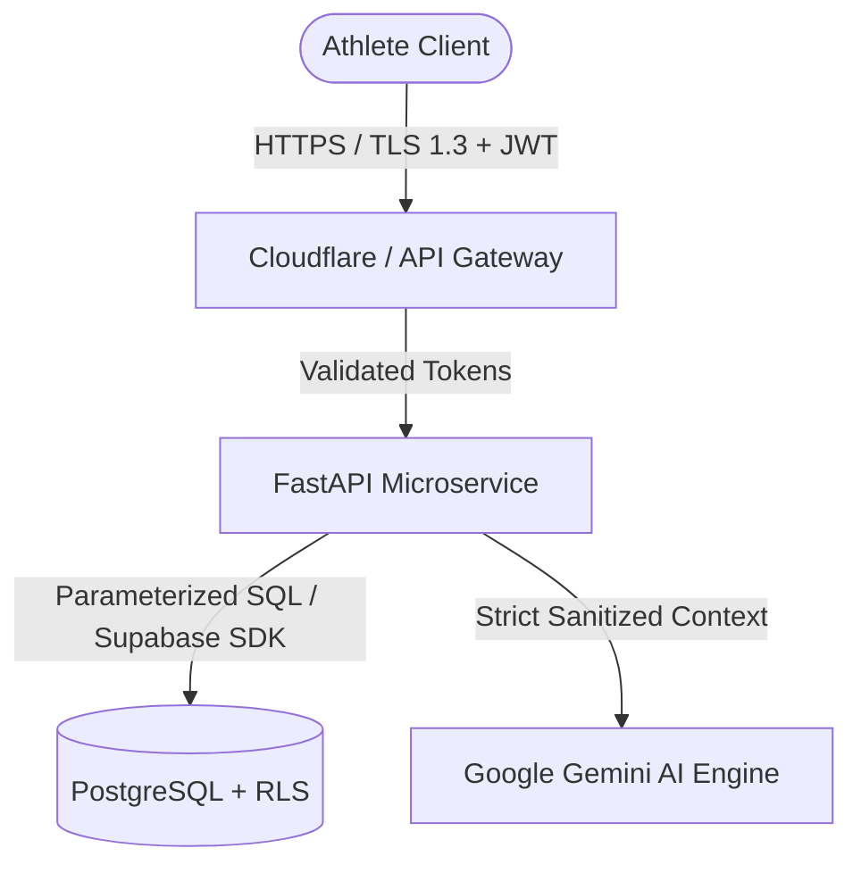

# AthlonIQ — Security, Privacy & Data Protection Specification

## 1. Threat Model & Security Posture
AthlonIQ stores sensitive biometric and athletic health data. Maintaining athlete trust requires rigorous security protocols at the network, application, and database levels.

---

## 2. Authentication & Authorization
- **Identity Provider**: Supabase Auth (OAuth2 / OpenID Connect + Email/Password + Magic Link).
- **Session Tokens**: JWT signed via asymmetric keys (RS256/ES256) or secure HMAC secrets.
- **Authorization**: Role-Based & Attribute-Based Access Control enforced at the DB level through PostgreSQL Row Level Security (RLS). Users can never access or modify records owned by other athletes.

---

## 3. API Security & Validation
1. **Pydantic Validation**: All incoming requests are strictly validated against Pydantic schemas. Unrecognized parameters are rejected.
2. **CORS Restrictions**: Explicit origin allowlists (`BACKEND_CORS_ORIGINS`). Wildcard (`*`) is banned in production.
3. **Rate Limiting**: Protection against brute-force authentication and spam on AI endpoints via token bucket algorithms.
4. **Content Security Policy (CSP)**: Strict headers configured on the Vite client to prevent XSS.

---

## 4. AI & Health Data Privacy
- **Sanitized Prompts**: Personal identifiable information (PII) such as full names, email addresses, or phone numbers are never forwarded to third-party LLMs.
- **Stateless Inference**: Athlete queries sent to the Gemini API are processed statelessly without model fine-tuning on user data.
- **Audit Logs**: Critical athlete mutations (e.g., account deletion, mass data export) generate immutable audit records.

---

## 5. PWA Service Worker & Safe Caching Policy

AthlonIQ strictly segregates static user interface code from confidential athlete records.

### Safe Caching Matrix

| Resource Category | Matcher / Pattern | Workbox Strategy | Storage Target | Rationale |
| :--- | :--- | :--- | :--- | :--- |
| **App Shell Assets** | `**/*.{js,css,html,ico,png,svg,woff2}` | `precacheAndRoute` | CacheStorage (`workbox-precache`) | Instant standalone app launch and navigation fallback. |
| **Supabase Cloud** | `^https://.*\.supabase\.co/.*` | `NetworkOnly` | **None (Zero Cache)** | Never write JWT tokens, database rows, or athlete identity to local disk. |
| **Backend API** | `/api/*`, `/health`, port 8000 | `NetworkOnly` | **None (Zero Cache)** | Calculation engines and Gemini AI chat turns must always reflect live state. |
| **Signed URLs** | `?token=`, `?Signature=`, `?sig=` | `NetworkOnly` | **None (Zero Cache)** | Expiring cryptographic tokens must not be persisted beyond lifetime. |
| **Private Photos** | `meal-photos`, `progress-photos` | `NetworkOnly` | **None (Zero Cache)** | Sensitive physique photos and meal uploads remain confidential. |

### Memory Isolation & Session Invalidation
1. **Zero Disk Storage**: Health telemetry, biometrics, weight readings, and chat histories are never written to `localStorage` or `IndexedDB`.
2. **Volatile Query Cache**: Active data records reside solely in volatile heap memory managed by TanStack Query (`queryClient`).
3. **Session Teardown**: Calling `signOut()` immediately invokes `queryClient.clear()` to destroy all in-memory query snapshots, preventing cross-athlete leakage on shared devices.
4. **Offline Integrity**: Generative AI coaching and vision photo analysis are blocked when offline. AthlonIQ strictly avoids simulating fake offline synchronization.

---

## 6. Database Functions & RLS Hardening
- **Function Permissions**: The hosted project's `rls_auto_enable()` function had `EXECUTE` revoked from `public`, `anon`, and `authenticated` (`REVOKE EXECUTE ON FUNCTION public.rls_auto_enable() FROM PUBLIC, anon, authenticated;`), preventing unauthorized execution of schema automation routines.
- **Search Path Isolation**: All trigger functions (including `handle_updated_at()` and `handle_new_athlete_signup()`) strictly enforce `SET search_path = public` to eliminate search-path injection vulnerabilities.

---

## 7. Public Reference Catalog vs. Authenticated Telemetry (`/tracking/foods`)

### Architecture Decision: Public with Rate Limiting
The endpoint `GET /api/v1/tracking/foods` is **public with IP-based rate limiting (60 requests per minute)**.

#### Security & Epistemic Separation Rationale
1. **Public Reference Data**: The 22+ item Indian & Athletic Food Catalog contains only verified, static nutritional benchmarks sourced from ICMR (2017) and published sports nutrition science. It contains zero athlete PII, zero tenant records, and zero private biometric data.
2. **Pre-Authentication UX & PWA Precache**: Making this endpoint accessible without a session token allows unauthenticated food searches during athlete onboarding, guest meal exploratory flows, and offline service worker precaching.
3. **Denial-of-Service & Scraping Protection**: To prevent scraping abuse and ASGI worker saturation, `/tracking/foods` enforces an in-memory sliding-window rate limit of 60 requests per minute per client IP. Requests exceeding this threshold receive HTTP 429 (`Too Many Requests`).
4. **Strict Isolation from Athlete Mutations**: In contrast to the read-only catalog, all endpoints that read or write athlete data (`/tracking/nutrition-summary`, `/tracking/running-pace`, `/tracking/progression-suggestion`, `/tracking/weight-trend`, `/vision/analyze-meal`, `/coaching/*`) strictly require cryptographic JWT validation via Supabase Auth (`Depends(get_current_user)`).

### Trusted Proxy Resolution (`X-Forwarded-For`)
- **First Hop Keying**: When requests arrive via a reverse proxy or load balancer, the rate limiter inspects the `X-Forwarded-For` header and extracts the **first hop** (the true client IP).
- **Trusted Proxy Guardrail**: The `X-Forwarded-For` header is only inspected if the immediate connection peer (`request.client.host`) matches the configurable `TRUSTED_PROXIES` setting (e.g. `["127.0.0.1", "::1"]`). Untrusted direct callers cannot spoof `X-Forwarded-For` to bypass or pollute rate limits.

### Rate Limiter Limitation (Per-Process Isolation)
> [!NOTE] In-Memory Rate Limiting Architecture Limitation
> The rate limiter state is currently maintained in ASGI process memory (`_food_catalog_rate_limits: Dict[str, List[float]]`).
>
> In multi-process deployments (e.g. `uvicorn --workers 4`) or multi-instance container environments (e.g. multiple Kubernetes pods or Cloud Run instances behind a load balancer), rate limits are enforced **per process** rather than cluster-wide. A client connecting across multiple workers may theoretically issue up to `workers * 60` requests per minute before being fully blocked.
>
> For enterprise distributed deployments where global rate enforcement is required, a centralized cache (such as Redis or Supabase PostgreSQL atomic counters) should replace the in-memory dictionary.

---

## 8. Production Environment Checklist

Before deploying the FastAPI backend and connecting live clients, verify the following mandatory production settings:

| Variable | Required Setting | Production Security Guarantee |
| :--- | :--- | :--- |
| `SUPABASE_URL` | `https://<project-ref>.supabase.co` | **Required**. Authoritative endpoint used by PyJWKClient to fetch public JWKS keys (`/auth/v1/.well-known/jwks.json`) and verify token issuer claims (`/auth/v1`). |
| `BACKEND_CORS_ORIGINS` | Explicit origin list (e.g., `["https://app.athloniq.io", "https://athloniq.app"]`) | **Must include the deployed frontend origin**. Wildcard (`*`) is strictly forbidden to prevent credentialed cross-origin attacks. |
| `ENVIRONMENT` | `production` | **Required**. Enforces production security guarantees: rejects client test overrides (e.g. `force_mode` on `/vision/analyze-meal`), enforces strict CORS origin checks, and disables debug tooling. |
| `DEBUG` | `false` | **Required**. Disables debug tracebacks, interactive exception reporting, and prevents internal error leakage to clients. |
| `DEV_AUTH_BYPASS` | `false` | **Required**. Strictly requires genuine cryptographic JWT verification against Supabase Auth for all protected endpoints; disables any mock user bypasses. |
