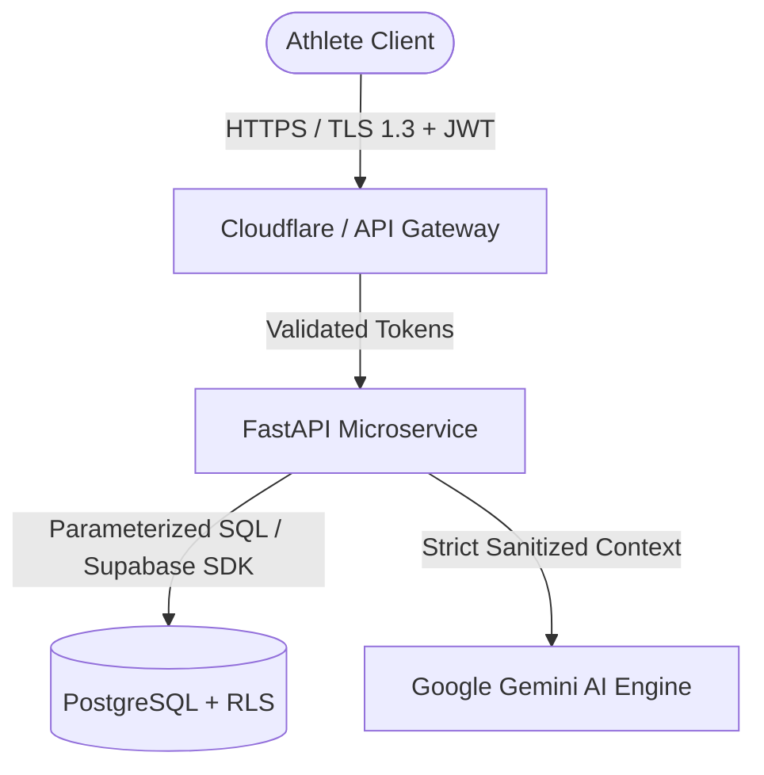

# AthlonIQ — Security, Privacy & Data Protection Specification

## 1. Threat Model & Security Posture
AthlonIQ stores sensitive biometric and athletic health data. Maintaining athlete trust requires rigorous security protocols at the network, application, and database levels.

---

## 2. Authentication & Authorization
- **Identity Provider**: Supabase Auth (OAuth2 / OpenID Connect + Email/Password + Magic Link).
- **Session Tokens**: JWT signed via asymmetric keys (RS256/ES256) or secure HMAC secrets.
- **Authorization**: Role-Based & Attribute-Based Access Control enforced at the DB level through PostgreSQL Row Level Security (RLS). Users can never access or modify records owned by other athletes.

---

## 3. API Security & Validation
1. **Pydantic Validation**: All incoming requests are strictly validated against Pydantic schemas. Unrecognized parameters are rejected.
2. **CORS Restrictions**: Explicit origin allowlists (`BACKEND_CORS_ORIGINS`). Wildcard (`*`) is banned in production.
3. **Rate Limiting**: Protection against brute-force authentication and spam on AI endpoints via token bucket algorithms.
4. **Content Security Policy (CSP)**: Strict headers configured on the Vite client to prevent XSS.

---

## 4. AI & Health Data Privacy
- **Sanitized Prompts**: Personal identifiable information (PII) such as full names, email addresses, or phone numbers are never forwarded to third-party LLMs.
- **Stateless Inference**: Athlete queries sent to the Gemini API are processed statelessly without model fine-tuning on user data.
- **Audit Logs**: Critical athlete mutations (e.g., account deletion, mass data export) generate immutable audit records.
